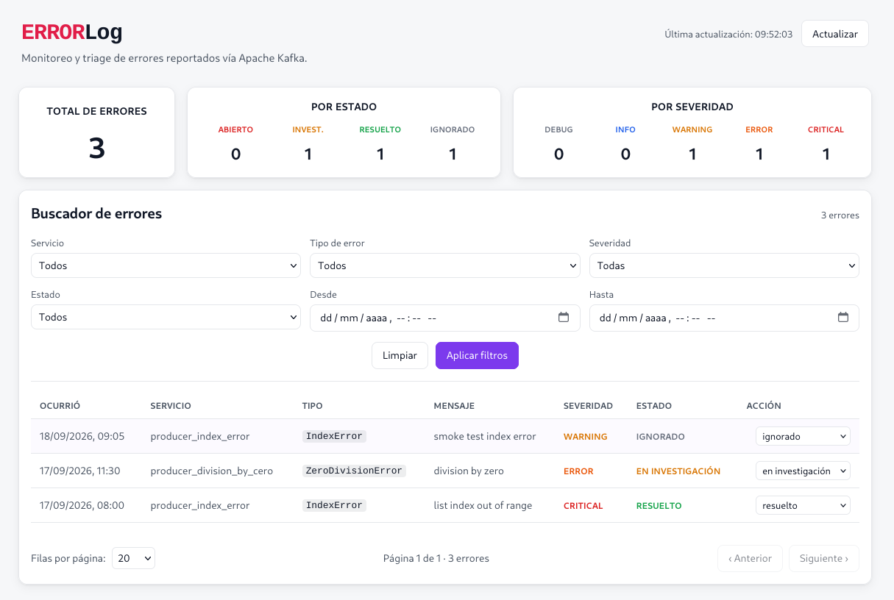

# ErrorLog - Sistema Log de Errores

Proyecto presentado como trabajo práctico final frente a la asignatura Administración de Bases de datos.

## Cátedra

**Alumnos**

- Aita Jerónimo
- Condo Kevin

**Cátedra**

- Universidad Tecnológica Nacional, Facultad Regional Delta
- Administración de Bases de datos 2026
- Profesor Vidal Jorge

**La consigna:** desarrollar una aplicación que utilice Apache Kafka.

### Apache Kafka

Plataforma de transmisión de datos distribuída, diseñada para manejar flujos de datos en tiempo real de manera escalable y de alto rendimiento.

Basado en mensajería publicador/suscriptor y registro de eventos: las aplicaciones publicadoras envían datos a Kafka, y las aplicaciones suscriptoras los consumen.

[Sitio web de Apache Kafka](https://kafka.apache.org/documentation/)

## Propuesta: Sistema log de errores

Como resolución al trabajo práctico, desarrollamos un **sistema de monitoreo de errores de aplicaciones distribuídas**.

El mismo formaría parte de una arquitectura de microservicios: resolviendo el monitoreo de avisos y alertas en logs de programas siendo ejecutados en contenedores o infraestructuras distintas.

Cuando una de las **aplicaciones principales** encuentra errores en tiempo de ejecución, las comunica a **nuestro sistema** para que los ingenieros de software analicen las incidencias de forma cómoda y con herramientas poderosas.

Principales ventajas del uso de nuestro sistema:

- **Desacoplamiento:** la app principal no necesita saber cómo se procesan los logs.
- **Persistencia:** los logs no se pierden por más que la app principal falle.
- **Orden:** los errores se procesan en el orden en el que ocurrieron.
- **Flexibilidad:** pueden desarrollarse más consumidores, como uno para notificaciones, otro para análisis de datos.

## Stack

- Apache Kafka
- Ruby / Ruby on Rails / Karafka
- Javascript / React / Vite / ESLint
- Docker
- SQLite
- Python

## Documentación adicional

- [Arquitectura del proyecto](docs/arquitectura.md)
- [Backend](backend/README.md)
- [Frontend](frontend/README.md)
- [API - Contrato de endpoints](docs/api.md)

## Levantar entorno de desarrollo

Puede levantarse el proyecto completo con Docker:

~~~
docker compose up
~~~

Los componentes y sus puertos se encuentran descritos en `docker-compose.yaml`. Un resumen:

Servicio | Puerto
--- | ---
Backend | `3000`
Frontend | `5173`
Kafka | `9092`
Kafka-ui | `8080`

### Probar el flujo completo con los producers

En `producers/` hay 5 scripts Python que generan errores a propósito y los
envían al tópico `error-logs`. Se ejecutan **en el host**, contra Kafka:

~~~bash
python3 -m venv venv
source venv/bin/activate
pip install -r producers/requirements.txt

python producers/producer_division_by_zero.py
python producers/producer_index_error.py
python producers/producer_key_error.py
python producers/producer_type_error.py
python producers/producer_file_not_found.py
~~~

Cada script imprime `Sent error-log to Kafka: <service_name> - <error_type>`.
Los eventos son persistidos por el consumer de Karafka y quedan disponibles en
la API (`curl http://localhost:3000/errors`) y en la interfaz web
(http://localhost:5173).

El broker se puede cambiar con la variable de entorno `KAFKA_BROKER`
(por defecto `localhost:9092`).
